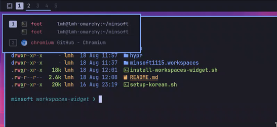

# omarchy-setup

**English** · [한국어](README.ko.md)

Setup scripts to run on a fresh [Omarchy](https://omarchy.org) (Arch +
Hyprland) machine.

Every script **runs on its own** and is **idempotent** — running it again is
safe, and anything already done is reported as skipped. Existing config files
are backed up as `*.bak.<timestamp>` before they are touched.

```
install.sh                 entry point — clone + pick what to install
scripts/                   the individual installers
minsoft1115.workspaces/    Quickshell plugin source (bar widget + shell service)
hypr/                      Hyprland Lua snippets (installed to ~/.config/minsoft1115/hypr/)
bash/                      alias and function sources (installed to ~/.config/minsoft1115/bash/)
lazygit/                   lazygit config (installed to ~/.config/lazygit/)
ccstatusline/              Claude Code status line config (installed to ~/.config/ccstatusline/)
lsp/                       Grok lsp.json (installed to ~/.grok/lsp.json)
docs/                      per-script documentation and research notes (Korean)
old/korean/                archived Korean input setup (replaced by Omarchy support)
```

---

## Everything in one line (install.sh)

Clones the repo, then asks what to install.

```bash
curl -fsSL https://raw.githubusercontent.com/minsoft1115/omarchy-setup/main/install.sh | bash
```

To read it before running it: fetch it with `-o install.sh`, `less` it, then
`bash install.sh`.

A `gum` checklist appears (space toggles, enter confirms):

```
What should be set up? (space toggles, enter confirms)
> [✓] [installed / outdated] Bash config — Alt-R history picker · fzf search and kill · delta diffs
  [✓] [not installed]        Lazygit — delta renders the diffs
  [✓] [not installed]        Claude status line — context · session/weekly gauges · reset countdowns
  [✓] [not installed]        LSP — language servers · Grok and Claude usable
  [✓] [not installed]        sudo-pop — privileged password prompts in a popup · polkit agent + sudo router · built from source
  [✓] [not installed]        Workspaces bar — hold Super to see which apps are where before switching
```

Each row says whether it is installed and whether it is current, and **only what
has work to do starts selected.** One failure does not stop the rest.

| Option | |
|---|---|
| `--all` | everything, without asking |
| `--only bash-config,sudo-pop` | by name (the first column of `--list`) |
| `--guards` / `--no-guards` | answer the `zz-pkg-guards.sh` question in advance |
| `--take-seat` / `--keep-omarchy-polkit` | answer whether sudo-pop should disable `omarchy.polkit` |
| `--list` | print what is available and its current state |
| `--dry-run` | show what would run, run nothing |
| `--dir <path>` | where to clone |
| `--remove` | undo. The same checklist appears with **nothing selected** |
| `--purge` | with `--remove`, deletes the clone at the end |

The clone is kept at `~/.local/share/minsoft1115/omarchy-setup`: the scripts
install *from* it, so editing a source there and re-running is how a change is
applied. Running it again starts with a pull.

See [docs/install.md](docs/install.md) for the details (Korean) — the three
states, what the checkboxes mean, and how removing differs.

---

# What gets installed

Six things. Each is its own script and can be run on its own; what it touches,
how it works and what can be tuned is in the linked document.

| | | |
|---|---|---|
| **Bash config** | Alt-R history picker · fzf search and kill · delta diffs · markdown through glow · optional guards that ask before `pacman` or `yay` runs | `install-bash-config.sh` · [docs](docs/bash-config.md) |
| **Lazygit** | diffs rendered through delta · installs lazygit itself if missing | `install-lazygit.sh` · [docs](docs/lazygit.md) |
| **Claude status line** | [ccstatusline](https://github.com/sirmalloc/ccstatusline) under the Claude Code prompt, two lines: model · repo · git branch · context gauge, then session/weekly usage gauges with reset countdowns · installs the package (mise, or npm if mise is missing) and registers it in `~/.claude/settings.json` | `install-ccstatusline.sh` · [docs](docs/ccstatusline.md) |
| **LSP** | nine language servers, then Grok and Claude made usable — Omarchy `~/.local/bin` wrappers, Grok `lsp.json` + `lsp_tools`, Claude official LSP plugins | `install-lsp.sh` · [docs](docs/lsp.md) |
| **sudo-pop** | the password prompt for privileged actions in a popup instead of the terminal — a polkit authentication agent, with a sudo router in front that sends plain commands through run0. [Its own repository](https://github.com/minsoft1115/sudo-pop) — this step clones and builds it | `install-sudo-pop.sh` · [docs](docs/sudo-pop.md) |
| **Workspaces bar** | hold Super to see which apps are where before switching · the focused workspace keeps its number | `install-workspaces-widget.sh` · [docs](docs/workspaces-widget.md) |



To run one without the checklist:

```bash
git clone https://github.com/minsoft1115/omarchy-setup.git
cd omarchy-setup
./scripts/install-bash-config.sh install
```

They run from inside the repo, because they install *from* it. Most take
`status` (the default), `install` and `remove`; `--help` on any of them says the
rest. If you have run `install.sh` once, the clone is already at
`~/.local/share/minsoft1115/omarchy-setup`.

---

## Korean input

Use Omarchy's built-in support (verified with 4.5rc3). With the interface in
English, add Hangul under **Setup > Typing > Input Methods**, or run:

```bash
omarchy setup input hangul
```

For Right Alt as 한/영 and Right Ctrl as 한자, select **Korean** under
**Setup > Typing > Keyboard Layouts** (`kr:kr104`). These typing settings keep
the interface language unchanged; `omarchy language ko` also changes the UI
language and locale.

The previous installer, Lua snippets, bar widget and documentation are preserved
in [old/korean/](old/korean/README.md). They are excluded from `install.sh`,
including `--all` and `--remove`. Existing installed settings are not removed
automatically.

To clean up settings installed by this repository, use the
[standalone uninstaller](docs/uninstall-korean.md):

```bash
./scripts/uninstall-korean.sh --dry-run
./scripts/uninstall-korean.sh
```

It keeps the fcitx5 profile, switching keys, packages and official keyboard settings.

---

## Documentation

**The files under `docs/` are written in Korean.** This README says what gets
installed and how to run it; those go into how each piece works, what it
touches, and why it was built that way — linked from the table above.

### Research notes

Not scripts — notes on how Omarchy itself works.

| Document | |
|---|---|
| [docs/quickshell-workspaces.md](docs/quickshell-workspaces.md) | how the workspace indicator in the Omarchy 4.0 bar is drawn — where the data comes from, the display rules, click behaviour, and where it can be customised |
| [docs/workspace-peek-design.md](docs/workspace-peek-design.md) | the design of the Super-hold preview and what was measured — key binding behaviour, the lost release event, and what was wrong about the popup size calculation |
